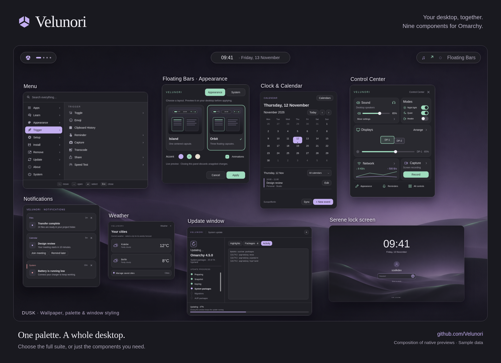

# Velunori

A complete desktop suite for **Omarchy**, with floating bars, coordinated panels and a graphite, lavender and mint palette.

[](https://velunori.github.io/)

<sub>Native component previews with sample data. Every component has its own repository, listed in [the suite](#the-suite).</sub>

### Start here

**[velunori.github.io](https://velunori.github.io/)**: pick the full suite or individual components and get a matching install command.

```bash
curl -fsSL https://velunori.github.io/install.sh | bash -s -- --all
```

Run it from an unlocked Omarchy desktop terminal, without `sudo`. Omit `--all` to choose components interactively. The script shows the plan, checks prerequisites and asks for confirmation before changing anything. The shared library is added automatically, and you can keep your current bar, theme or lock screen. Read the [installation guide](https://velunori.github.io/guide.html) for requirements, recovery and current limits.

### The suite

| Repository | What it provides |
| --- | --- |
| **[velunori](https://github.com/Velunori/velunori)** | **Suite composition, pinned versions and the installer** |
| [lib](https://github.com/Velunori/lib) | Shared design kit, palette, branding and panel geometry for every component |
| [bar](https://github.com/Velunori/bar) | Optional Island and Orbit Floating Bars with appearance settings |
| [clock](https://github.com/Velunori/clock) | Clock, calendar and local/Google/iCloud events |
| [control-center](https://github.com/Velunori/control-center) | Sound, displays, network, capture and reminders |
| [notifications](https://github.com/Velunori/notifications) | Notification cards and session history |
| [menu](https://github.com/Velunori/menu) | Two-pane Omarchy menu and prompts |
| [weather](https://github.com/Velunori/weather) | Saved cities and a weekly forecast |
| [update](https://github.com/Velunori/update) | A window for Omarchy's system updater |
| [lockscreen](https://github.com/Velunori/lockscreen) | Serene lock screen using Omarchy's lock service |
| [theme](https://github.com/Velunori/theme) | Palette, Dusk wallpaper and window styling |

### Contribute

Want to create another component? Start with the [plugin-author guide](https://github.com/Velunori/.github/blob/main/docs/plugin-authoring.md), then read [how plugins join the suite](https://github.com/Velunori/.github/blob/main/docs/suite-inclusion.md).

Read the [contribution guidelines](https://github.com/Velunori/.github/blob/main/CONTRIBUTING.md) for development setup, checks and pull requests. Use the [issue forms](https://github.com/Velunori/velunori/issues/new/choose) for installation problems, or report a component issue in its repository. See [support](https://github.com/Velunori/.github/blob/main/SUPPORT.md), our [Code of Conduct](https://github.com/Velunori/.github/blob/main/CODE_OF_CONDUCT.md) and [private security reporting](https://github.com/Velunori/.github/blob/main/SECURITY.md).

<sub>[Support Velunori development](https://revolut.me/szalikdev)</sub>
